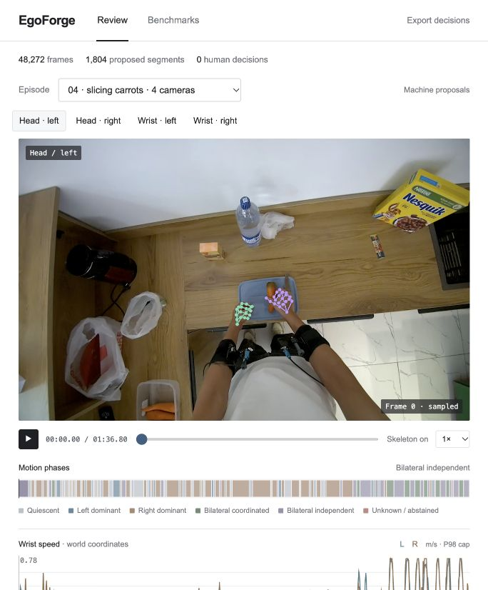

# EgoForge

**Multimodal egocentric motion annotation with traceable cleaning and quality control.**

EgoForge turns synchronized first-person camera, hand-pose and IMU streams into reviewable bimanual motion intervals. The difficult part is distinguishing motion from tracking failure, temporal flicker and coordinate inconsistency while preserving the evidence behind each label.

The included run uses **48,272 frames from nine real episodes**, **964,596 IMU samples**, and **four synchronized camera views for a 96.8-second manipulation episode**. Source data is the [Humanola egocentric-sample](https://huggingface.co/datasets/humanola-inc/egocentric-sample), licensed **CC BY 4.0** by its publisher. Existing poses, keypoints and task names belong to the source; EgoForge adds the cleaning, QA, temporal proposals, recurrence candidates and review system.



## Inspect the results

- [Computed results](evidence/run/REPORT.md)
- [Executed validation](docs/VALIDATION.md)
- [Measured benchmarks](docs/BENCHMARKS.md)
- [Visual contact sheet](evidence/previews/contact_sheet.jpg)
- [Annotation specification](docs/ANNOTATION_SPEC.md)
- [Source dataset card](docs/DATASET_CARD.md)
- [Temporal method](docs/temporal-method.md)
- [Review guide](docs/review-guide.md)

## Run locally

Use Python 3.12 and [uv](https://docs.astral.sh/uv/). The measured environment was macOS; CI also checks the source on Linux.

```bash
git clone https://github.com/amemon12/egoforge.git
cd egoforge
uv sync --extra dev
uv run python scripts/acquire.py
uv run egoforge run
uv run egoforge serve
```

The first acquisition downloads about 751 MiB of pinned source data. The repository includes compact evidence snapshots; generated runtime tables and source videos are rebuilt by the commands above. A [release bundle](https://github.com/amemon12/egoforge/releases/latest) includes the already-generated annotations and reports; source recordings still use the verified downloader.

Open **http://127.0.0.1:8765**. The console plays real footage, overlays inherited hand skeletons, shows new phase proposals, plots wrist motion, surfaces QA evidence, and records explicit reviewer decisions. The initial release contains **zero human-reviewed phase labels**. No account, API key, GPU or external service is needed after acquisition.

## Validate and benchmark

```bash
uv run egoforge verify
uv run pytest -q

# Three isolated CPU passes and baseline-adjusted corruption sweeps.
uv run python scripts/run_benchmarks.py --repeats 3
```

A source-only checkout runs 72 tests and skips five checks that require downloaded source data or generated artifacts. After acquisition and a full pipeline run, all 77 checks run.

Use `uv run egoforge run --skip-media --output output/kinematic-run` for a faster pose/IMU-only pass. Use a new output directory when changing the configuration after review decisions exist. Source files under `data/raw/` are immutable inputs; they are never overwritten by the pipeline.

## Implemented methods

1. **Pinned acquisition and lineage.** Upstream LFS/Git checksums, local SHA-256, source revision, acquisition manifest, configuration and code hashes. Every proposed interval points back to its episode checksum.
2. **Geometric and temporal QC.** Camera-to-world quaternion transforms, camera-space consistency, 2D reprojection residuals, hand skeleton bone-length deviations, hand-presence contradictions, timestamp continuity, grip ranges, and motion outliers. Cross-sensor synchronization uses an explicit shared-clock diagnostic; no timing correction is silently applied.
3. **Reversible cleaning.** Retain every source row; mask absent or quarantined poses in a derived copy; apply short-window polynomial filtering only within valid spans; preserve source and reconciled task indices side by side.
4. **Duration-constrained temporal decoding.** Quality-tempered emissions and expanded-state Viterbi enforce minimum interior dwell, reset at gaps, preserve censored boundaries, and expose entropy/margin diagnostics. Five motion phases plus `unknown` describe observable wrist motion.
5. **Recurrence discovery.** World-frame wrist trajectories, principal-axis projection, detrending, autocorrelation and peak consistency produce experimental repeated-motion bouts. Cycles are not counted as completed actions.
6. **Review operations.** Risk and diversity sampling, frame/segment evidence, four camera selections, keyboard navigation, explicit accept/reject/correct decisions, append-only hash chaining, stale-proposal rejection, and export.
7. **Evaluation.** Seeded corruption sensitivity, exact decoder tests, signal recovery tests, API/security tests, source anomalies, and temporal ablations. No semantic accuracy or human agreement is invented.

## Real source issues surfaced

- The declared task count is **1**, while the task lookup contains **8** entries.
- **7,201 episode-2 rows** carry task index `0` although the episode table identifies `2`, “wiping.” The derived mapping records this override and retains the original.
- Episode 2, frame **5901**, has contradictory presence and tracking-quality flags.
- Three hand observations are absent. Geometry residuals create additional threshold-based review candidates; those are not automatically confirmed labeling errors.

## Outputs

| Artifact | Purpose |
|---|---|
| `annotations.parquet` | One row per source frame: phase, uncertainty, motion evidence, QA flags and lineage |
| `annotations.jsonl` / `segments.json` | Half-open temporal intervals and evidence |
| `cleaned/*.parquet` | Derived filtered world poses with retained frame IDs and usability masks |
| `cleaning_log.jsonl` | Metadata overrides and per-episode cleaning accounting |
| `qa/*.json` / `media_qa.json` | Geometric, temporal, IMU and sampled image diagnostics |
| `recurrence.json` | Experimental periodic-motion windows and bouts |
| `review_queue.json` / `reviews.jsonl` | Ranked proposals and subsequent reviewer decisions |
| `benchmark.json` / `ablation.json` | Fault sensitivity and temporal-stability evidence |
| `output/benchmarks/` | Repeated runtime measurements, memory use, threshold sweeps and raw results |
| `exports/` | Label Studio predictions and labeling configuration |
| `provenance.json` / `artifact_manifest.json` | Configuration, code lineage and output checksums |

The four source videos stay outside Git. The console serves them locally with byte-range seeking. Label Studio exports use 1-based inclusive frame ranges; native intervals use 0-based half-open ranges. A local media URL must be reachable from the browser running Label Studio; an import into a separate hosted instance is not tested.

## What is established, and what remains

This release establishes a working, executed annotation engineering pipeline on openly licensed real data. It does **not** establish physical pose accuracy, object-contact truth, cutting success, semantic phase accuracy, or deployment performance. Proposed state names describe motion patterns, not inferred intention. Independent human adjudication and a task-specific gold set are the next validation step. Episode splits are fixed, but subject/session separation cannot be verified from the available metadata.

Code: MIT. Source and derived data retain the applicable CC BY 4.0 attribution requirements. See [third-party notices](THIRD_PARTY_NOTICES.md) and [provenance](docs/PROVENANCE.md).
