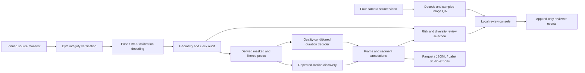

# System architecture

`data.py` decodes inherited observations and conventions. `quality.py` supplies masks, evidence and audit counts. `synchronization.py` maps shared-clock sensor timestamps. `temporal.py` owns motion proposals, independently testable without videos. `recurrence.py` analyzes periodic structure. `pipeline.py` assembles deterministic artifacts and lineage. `review.py` serves only local project artifacts and records review events.

Raw data and derived representations have separate paths. A source SHA-256 and frame index are the stable join key. A run ID incorporates input-manifest, code and configuration hashes. A review token binds decisions to the displayed proposal and run. Output checksums exclude the mutable review log; that log has its own chain.

The pipeline is intentionally local and inspectable. It does not train a perception network or hide pretrained model calls. Geometry agreement between two inherited representations can detect corruption and convention mistakes, but their errors may be correlated. The source tracking is not an independent gold standard.
